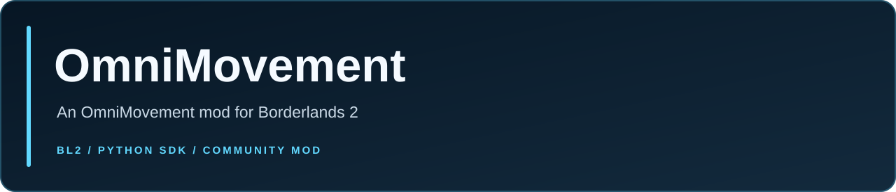

  <a href="#features">Features</a> ·
  <a href="#installation">Installation</a> ·
  <a href="#usage">Usage</a> ·
  <a href="#compatibility">Compatibility</a> ·
  <a href="#documentation">Documentation</a>

---

## Features

- Sprint forward, sideways, or backward with **Omnidirectional Sprint**.
- Switch between remembered Walk and Sprint modes using **Sprint Assist**.
- Customize direction transitions and enable **Coyote Time** for a brief jump window after leaving a ledge.
- Continue sprinting while hip-firing, with an optional setting to begin sprinting while firing.
- Keep the weapon reticle and walking accuracy while sprinting, with optional partial-stick **Precision Sprint**.

## Installation

1. Install [PythonSDK and Willow2 Mod Manager](https://bl-sdk.github.io/willow2-mod-db/).
2. Close Borderlands 2 and back up `sdk_mods/OmniMovement/` and your saved SDK settings.
3. Download the matching **Player ZIP** from the [Releases page](https://github.com/PeytonBlakeslee/OmniMovement/releases), then extract its `OmniMovement/` folder into `Borderlands 2/sdk_mods/`. Remove duplicate installations.
4. Confirm `sdk_mods/OmniMovement/__init__.py`, then launch the game and enable **OmniMovement** in the SDK Mods menu.

**Download:** Use the matching Player ZIP on the [Releases page](https://github.com/PeytonBlakeslee/OmniMovement/releases). If no public download is listed, publication is still pending. GitHub's automatic source ZIP is not an installable Player package.

See the [player guide](mod/OmniMovement/README.md#installation) for updates, rollback, and troubleshooting.

## Usage

1. Use your normal Sprint action to switch between Walk and Sprint when **Sprint Assist** is enabled (On by default).
2. Adjust **Direction Changes**, **Coyote Time**, reticle, and optional precision controls in the SDK Mods menu.
3. **Sprint While Hip-Firing** and **Begin Sprint While Firing** are both On by default. Disable/re-enable the mod after changing Begin Sprint While Firing to apply the setting.

**Safety:** Beginning sprint while firing changes live game-script state. If a restoration warning appears or firing remains stuck, fully exit the game before restarting. [Recovery details](mod/OmniMovement/README.md#recovery-and-troubleshooting).

## Compatibility

**Windows Borderlands 2** is the primary Player target. The maintainer reported a limited gameplay smoke test of version 1.1.17 with the six mods installed; a separate clean-install test has not been performed. The Pre-Sequel is unsupported; co-op and Proton/Wine remain unverified. Native Linux BL2 is unsupported by this Win32 package. [Compatibility details](docs/COMPATIBILITY.md).

## Documentation

[Player guide](mod/OmniMovement/README.md) · [Sprint-firing guide](docs/SPRINT_FIRING.md) · [Compatibility](docs/COMPATIBILITY.md) · [Troubleshooting](mod/OmniMovement/README.md#recovery-and-troubleshooting) · [Building](BUILDING.md) · [Report an issue](https://github.com/PeytonBlakeslee/OmniMovement/issues) · [MIT license](LICENSE) · [Third-party notices](THIRD_PARTY_NOTICES.md)

---

Other Borderlands 2 mods

- [No Warp Tunnel](https://github.com/PeytonBlakeslee/NoWarpTunnel)
- [Auto Pickup](https://github.com/PeytonBlakeslee/AutoPickup)
- [Loot Recovery](https://github.com/PeytonBlakeslee/LootRecovery)
- [Controller Manager](https://github.com/PeytonBlakeslee/ControllerManager)
- [Controller Deadzone Control](https://github.com/PeytonBlakeslee/ControllerDeadzone)

